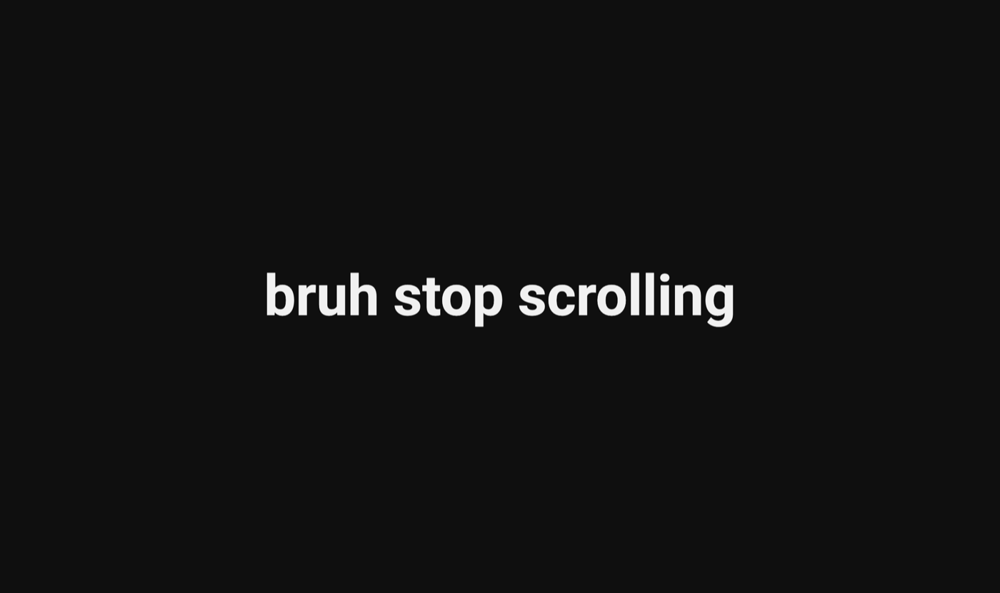
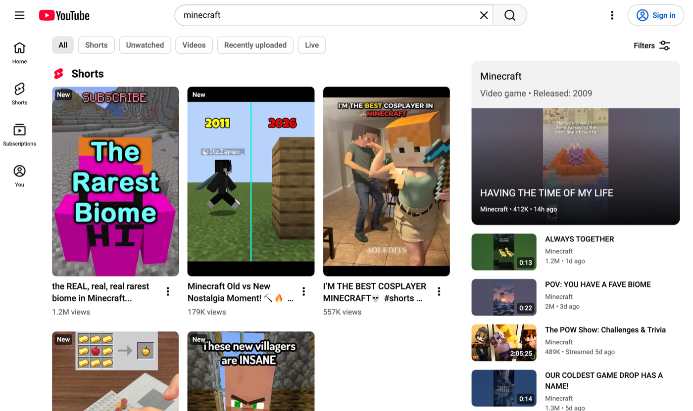
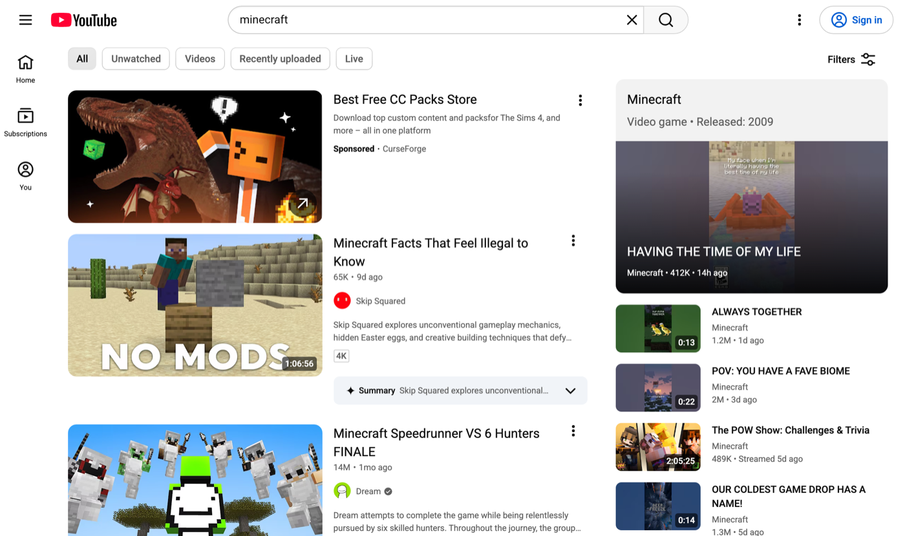

# 🚫📱 YouTube: No Shorts

**Hide YouTube Shorts (and the ad blocks) everywhere. If you end up on a Short anyway: _bruh stop scrolling_.**

Works with **Tampermonkey** and **Violentmonkey** · Chrome, Firefox, Edge, Safari · desktop and m.youtube.com

## Install

1. Get a userscript manager: [Tampermonkey](https://www.tampermonkey.net/) or [Violentmonkey](https://violentmonkey.github.io/).
2. **[Click here to install](https://raw.githubusercontent.com/prominence-chan/yt-no-shorts/main/yt-no-shorts.user.js)** and hit *Install* / *Confirm*.
3. Reload YouTube. Updates arrive automatically through your userscript manager.

## What it hides

| Where | What goes away |
|---|---|
| Home & Subscriptions | the Shorts shelves and any Shorts tiles in the feed |
| Search | Shorts results, Shorts shelves and the **Shorts** filter chip |
| Channels | the **Shorts** tab |
| Sidebar | the **Shorts** entry (full and mini guide) |
| Watch page | Shorts in the recommendations |
| Mobile site | Shorts shelves, tiles and the bottom-bar tab |
| Ad blocks | in-feed and search ads, the home masthead ad, sponsored sidebar cards, companion / overlay / promo banners (video ads still play, only the boxes go) |
| `/shorts/...` pages | the player is hidden and paused, you get **bruh stop scrolling** |

## Before / after

| Before | After |
|---|---|
|  |  |

## How it works

- A stylesheet injected at `document-start` hides every Shorts-shaped element (shelves, `/shorts/` links, tabs, chips),
  so there's no flash of Shorts while the page loads.
- A small sweeper handles what CSS can't select (the "Shorts" filter chip, shelves titled "Shorts") and re-runs as
  YouTube's single-page app swaps content in.
- On `/shorts/*` it hides the Shorts player, pauses and mutes any video, and shows the message. Navigating away
  removes it.
- No network requests, no tracking, no settings to break: about 100 lines you can read in a minute.

## FAQ

**YouTube changed its layout and Shorts are back.** Open an [issue](https://github.com/prominence-chan/yt-no-shorts/issues)
with the page URL; selectors get updated in a new release and your manager picks it up.

**Can I still watch a specific Short?** Not while the script is on, that's the point. Toggle it off in your userscript
manager for a moment.

## Changelog

See [CHANGELOG.md](CHANGELOG.md).

## License

MIT
